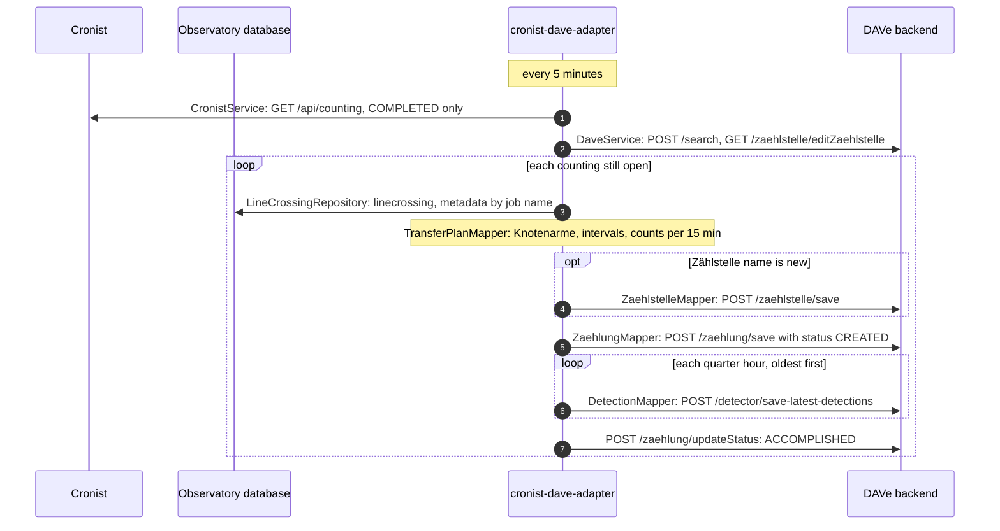
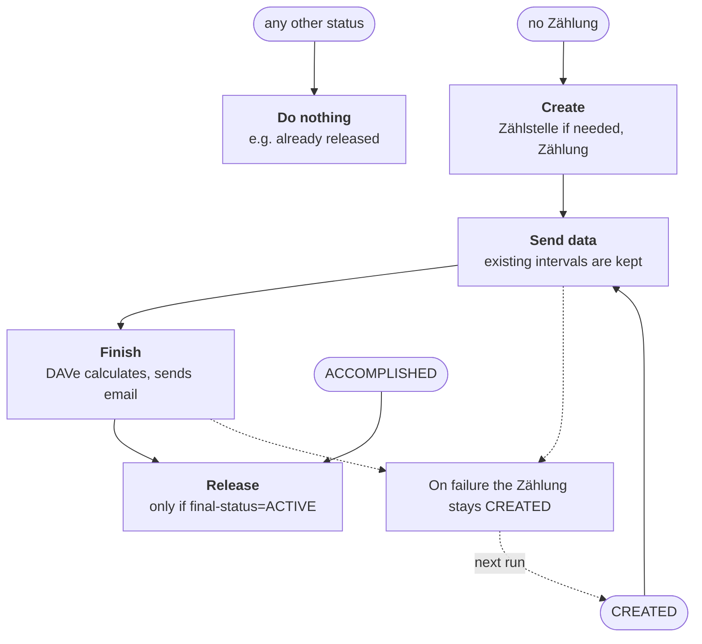

# Cronist-DAVe-Adapter

The adapter transfers completed countings from Cronist, along with their line crossings from Observatory, to DAVe. It has no database of its own: on every run it reads from DAVe what has already been transferred.

## How the data flows

The numbers show the order. Quarter hours are sent one at a time, oldest first, because only then does DAVe fill missing Fahrbeziehungen with zeros and skip intervals it already has.

## Where a counting enters the process

The status of the Zählung in DAVe is found by its `projektNummer` `cronist-<id>`.

The status in DAVe decides where the transfer continues, so a run can stop at any point without the adapter having to remember anything. Skipping existing intervals only exists in the starwit/dave-backend version.

## What becomes what

| Source | In DAVe | Rule |
|---|---|---|
| Observation area | Zählstelle | The name goes into `nummer`, as DAVe has no name field. A Zählstelle with the same name is reused. |
| Counting | Zählung | `projektNummer = cronist-<id>` links it to the counting. |
| Counting line with direction | Knotenarm | N=1, E=2, S=3, W=4, NE=5, SE=6, SW=7, NW=8. At least two directions are needed. |
| Line crossings of an object | Detection | An object counts if it enters through one line and leaves through another. It counts in the quarter hour it leaves in. |
