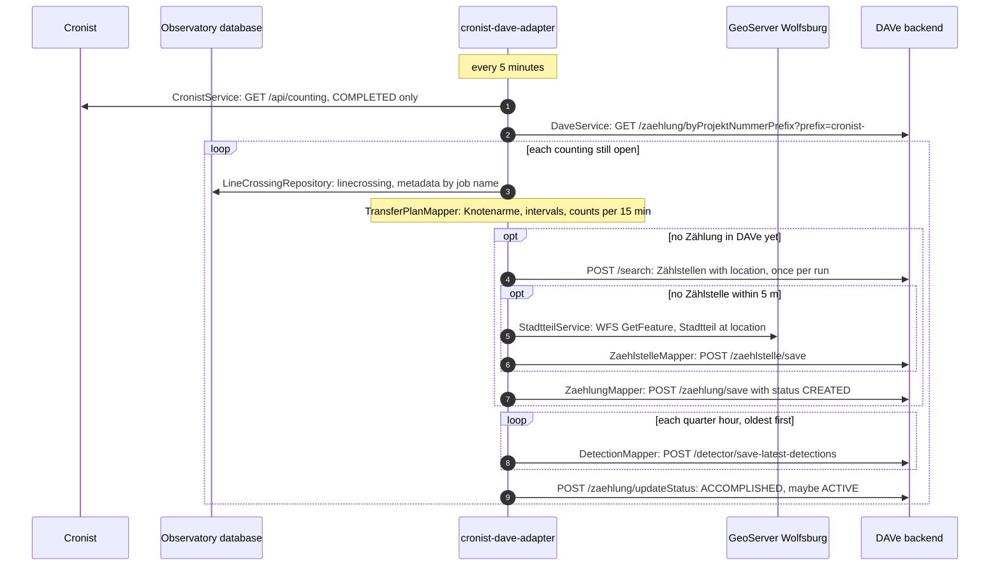
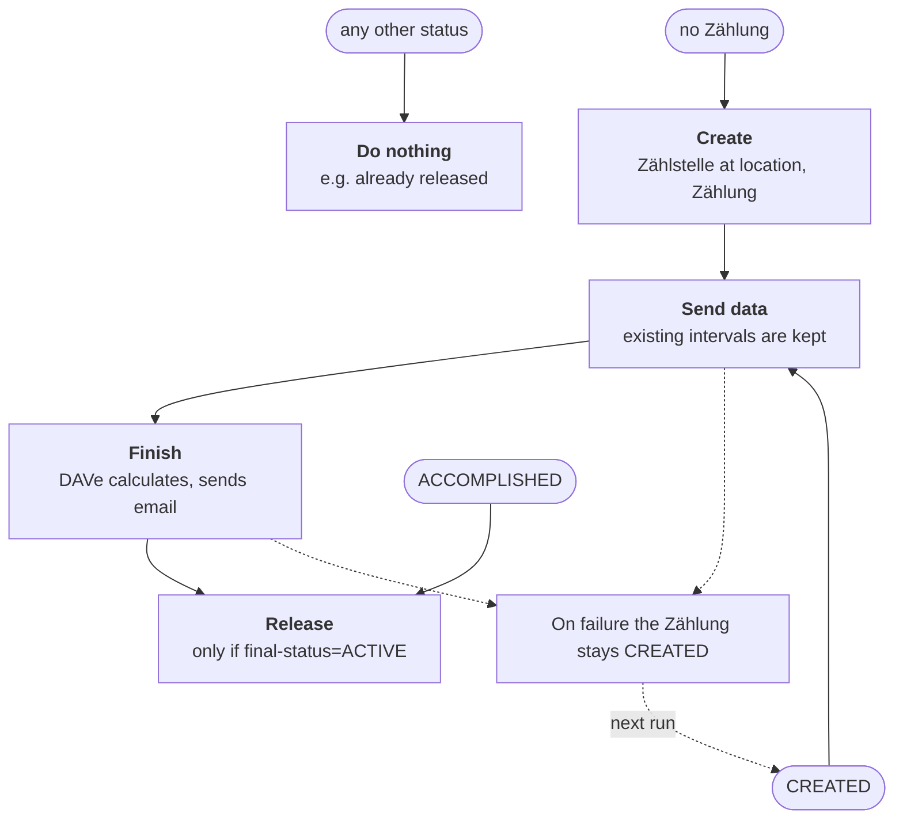

# Cronist-DAVe-Adapter

The adapter transfers completed countings from Cronist, along with their line crossings from Observatory, to DAVe. It has no database of its own: on every run it reads from DAVe what has already been transferred.

## How the data flows

The numbers show the order. The adapter finds the Zählungen with one call per run by their projektNummer, whatever Zählstelle they are in. It only asks for Zählstellen and the GeoServer when a Zählung is created. Quarter hours are sent one at a time, oldest first, because only then does DAVe fill missing Fahrbeziehungen with zeros and skip intervals it already has.

## Where a counting enters the process

The status of the Zählung in DAVe is found by its `projektNummer` `cronist-<id>`, whatever its Zählstelle.

The status in DAVe decides where the transfer continues, so a run can stop at any point without the adapter having to remember anything. Skipping existing intervals only exists in the starwit/dave-backend version.

## What becomes what

| Source | In DAVe | Rule |
|---|---|---|
| Observation area | Zählstelle | Identified by location: a Zählstelle within 5 m is reused and never changed, otherwise one is created. DAVe assigns the `nummer`. The name goes into `kommentar` as `<name> - Cronist` and into the search words. |
| Location of the area | Stadtbezirk | The GeoServer of the city of Wolfsburg returns the Stadtteil, `adapter.dave.stadtbezirk-mapping` maps it to the number in DAVe. Without a match `adapter.dave.stadtbezirk-nummer` applies, 130 (Stadtmitte) by default. |
| Counting | Zählung | `projektNummer = cronist-<id>` links it to the counting, even if the area was moved. |
| Counting line with direction | Knotenarm | N=1, E=2, S=3, W=4, NE=5, SE=6, SW=7, NW=8. At least two directions are needed. |
| Line crossings of an object | Detection | An object counts if it enters through one line and leaves through another. It counts in the quarter hour it leaves in. |
