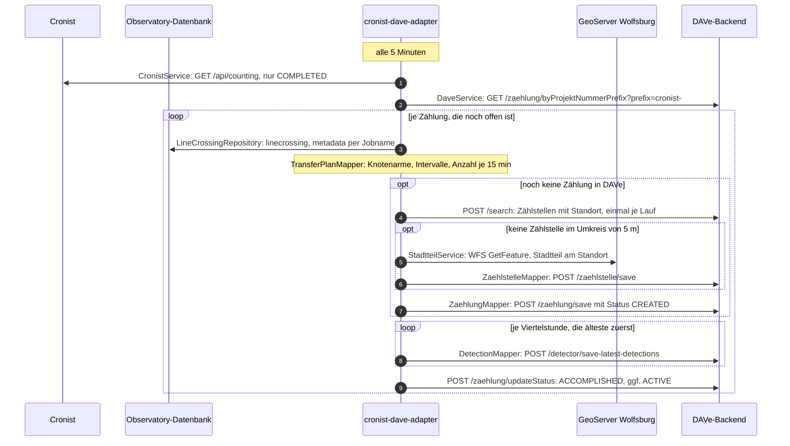
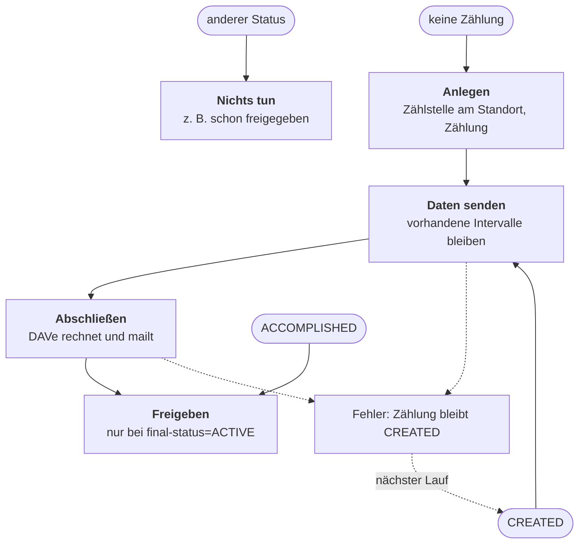

# Cronist-DAVe-Adapter

Der Adapter überträgt abgeschlossene Zählungen aus Cronist samt den Linecrossings aus Observatory nach DAVe. Er hat keine eigene Datenbank: Was schon übertragen ist, liest er bei jedem Lauf aus DAVe.

## Wie die Daten fließen

Die Nummern zeigen die Reihenfolge. Die Zählungen findet der Adapter mit einem Aufruf je Lauf über ihre Projektnummer, egal an welcher Zählstelle sie hängen. Zählstellen und GeoServer fragt er nur ab, wenn eine Zählung neu angelegt wird. Die Viertelstunden gehen einzeln und mit der ältesten zuerst an DAVe, weil DAVe nur so fehlende Fahrbeziehungen mit Nullen auffüllt und schon vorhandene Intervalle überspringt.

## Wo eine Zählung einsteigt

Der Status der Zählung in DAVe wird über die `projektNummer` `cronist-<id>` gefunden, unabhängig von der Zählstelle.

Der Status in DAVe entscheidet, wo der Transfer weitergeht. Deshalb kann ein Lauf an jeder Stelle abbrechen, ohne dass der Adapter sich etwas merken muss. Das Überspringen vorhandener Intervalle gibt es nur im Backend von starwit/dave-backend.

## Was woraus wird

| Quelle | In DAVe | Regel |
|---|---|---|
| Observation Area | Zählstelle | Erkannt am Standort: Eine Zählstelle im Umkreis von 5 m wird wiederverwendet und nie geändert, sonst wird eine angelegt. Die `nummer` vergibt DAVe. Der Name steht im `kommentar` als `<Name> - Cronist` und als Suchwort. |
| Standort der Area | Stadtbezirk | Der GeoServer der Stadt Wolfsburg liefert den Stadtteil, `adapter.dave.stadtbezirk-mapping` ordnet ihm die Nummer in DAVe zu. Ohne Treffer gilt `adapter.dave.stadtbezirk-nummer`, standardmäßig 130 (Stadtmitte). |
| Counting | Zählung | `projektNummer = cronist-<id>` ordnet sie dem Counting zu, auch wenn die Area verschoben wurde. |
| Zähllinie mit Richtung | Knotenarm | N=1, E=2, S=3, W=4, NE=5, SE=6, SW=7, NW=8. Es braucht mindestens zwei Richtungen. |
| Linecrossings eines Objekts | Detection | Gezählt wird, wer über eine Linie herein- und über eine andere hinausfährt, in der Viertelstunde des Hinausfahrens. |
