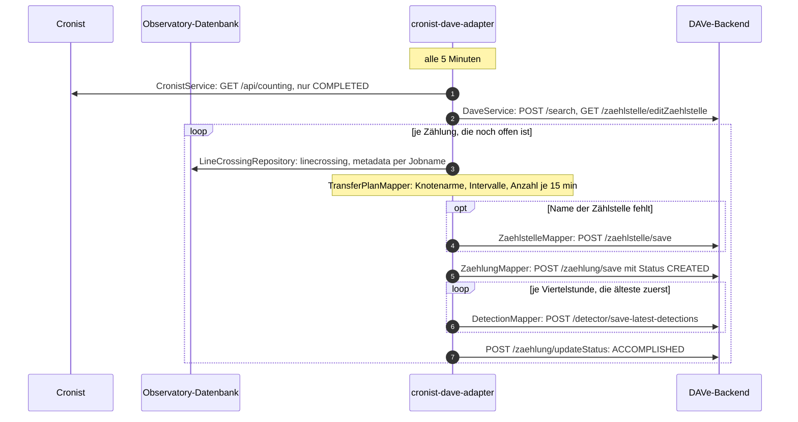
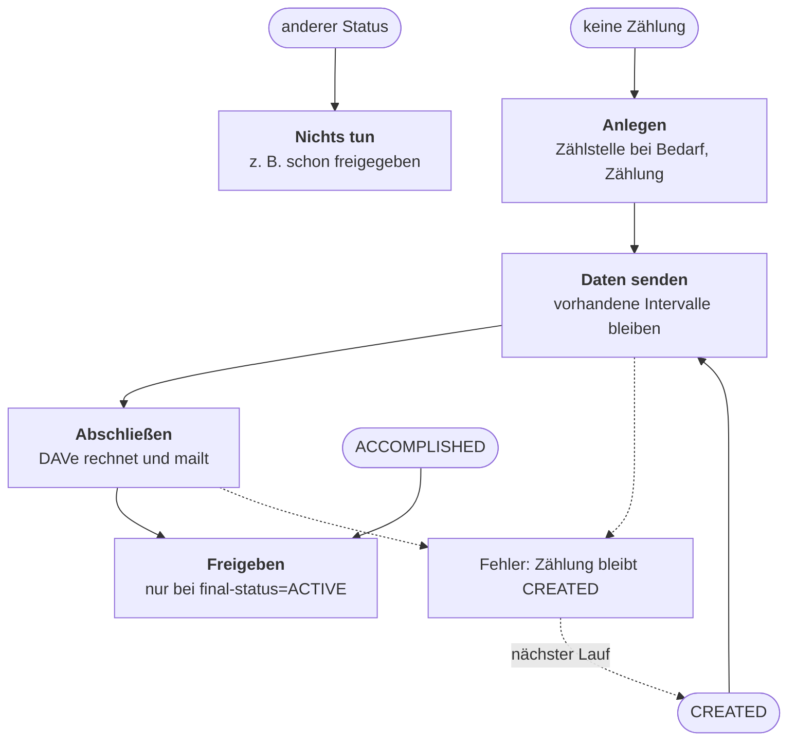

# Cronist-DAVe-Adapter

Der Adapter überträgt abgeschlossene Zählungen aus Cronist samt den Linecrossings aus Observatory nach DAVe. Er hat keine eigene Datenbank: Was schon übertragen ist, liest er bei jedem Lauf aus DAVe.

## Wie die Daten fließen

Die Nummern zeigen die Reihenfolge. Die Viertelstunden gehen einzeln und mit der ältesten zuerst an DAVe, weil DAVe nur so fehlende Fahrbeziehungen mit Nullen auffüllt und schon vorhandene Intervalle überspringt.

## Wo eine Zählung einsteigt

Der Status der Zählung in DAVe wird über die `projektNummer` `cronist-<id>` gefunden.

Der Status in DAVe entscheidet, wo der Transfer weitergeht. Deshalb kann ein Lauf an jeder Stelle abbrechen, ohne dass der Adapter sich etwas merken muss. Das Überspringen vorhandener Intervalle gibt es nur im Backend von starwit/dave-backend.

## Was woraus wird

| Quelle | In DAVe | Regel |
|---|---|---|
| Observation Area | Zählstelle | Der Name steht in `nummer`, weil DAVe kein Namensfeld hat. Eine gleichnamige Zählstelle wird wiederverwendet. |
| Counting | Zählung | `projektNummer = cronist-<id>` ordnet sie dem Counting zu. |
| Zähllinie mit Richtung | Knotenarm | N=1, E=2, S=3, W=4, NE=5, SE=6, SW=7, NW=8. Es braucht mindestens zwei Richtungen. |
| Linecrossings eines Objekts | Detection | Gezählt wird, wer über eine Linie herein- und über eine andere hinausfährt, in der Viertelstunde des Hinausfahrens. |
